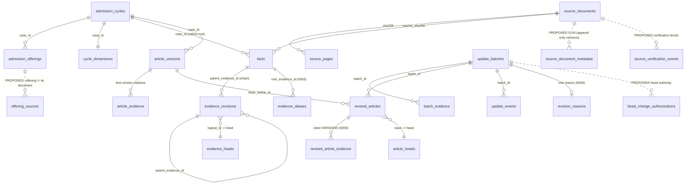

# M1 統一データアーキテクチャ RFC（設計凍結の候補）

**ラベル：`SELF_VALIDATED`（Claude 単独の設計レビュー）・`WORK_REVIEW_PENDING`。** **2026-11-01：ユーザーが `M1_FINAL_APPROVAL_ITEMS.md` の推奨案を承認した（設計の採用。F-2 の受容・署名鍵・運用DBへの適用・PR #61 の有効化は含まない）。** Work の独立レビューは**まだ**受けていない。この文書は既存の承認済み契約（`DB_ACCEPTANCE_CONTRACT_V1.md`、`DB_MIGRATION_REQUIREMENTS.md`、`DB_MIGRATION_POLICY.md`、`PUBLICATION_POLICY.md`）を**書き換えない**。矛盾する場合は §14 に「現行契約／現行実装／問題／提案／理由／互換性／承認状態」を並べる。**設計の確定は、運用DBの変更・未承認の有効化の許可ではない。** 基点：master `1dc93a5`（PR #68〜#71 統合）＋ PR #72（G-07・G-11、未マージ・CI 成功）。関連：`M1_DESIGN_DECISION_MATRIX.md`、`M1_SAFE_MIGRATION_PLAN.md`、`M1_FINAL_APPROVAL_ITEMS.md`、`tests/test_unified_design_falsification.py`、`SYSTEM_ARCHITECTURE_RFC.md`（事業全体）。

## 1. 目的と結論
G-02〜G-11 を個別の修正の集合としてでなく、**一つのデータベースの統一仕様**として検証した。コードと SQL を読み、隔離した合成 DB で反証した。
**結論：設計は統一できる（`DESIGN_FREEZE_READY`）。ただし、マージ済みの G-09（PR #71）は最終の保護として不十分で、設計の修正が要る。** 主な発見（再現は §11、試験は `tests/test_unified_design_falsification.py`）：
1. **直接 SQL で、未承認の候補版を有効な head にでき、QA を偽造して candidate を承認にできる**（INV-06・INV-12 が未達）。原因：Work の `finalize` が head を書いた**後に** batch を approved にするため、head のトリガーが `candidate` を許す必要があった。
2. `INSERT OR REPLACE` が、追記専用の表・承認済み batch・記事版を黙って上書きする（既定の SQLite 設定）。
3. 保護トリガーを `DROP` しても、移行ランナーは**ドリフトを検出しない**。G-09 の checksum は、生成するトリガー SQL を**覆っていない**。
4. `resolve()` は、改訂版の ID を渡すと**その ID 自身を root として返す**。固定版の判定は**4 世代で打ち切られる**（正当な 6 世代目を拒否）。巡回した改訂系列は root が無く、影響分析から**黙って消える**。
5. offering の同一性に原典 SHA を含めたため、**改訂された募集要項が同じ募集の 2 行目になる**。
**推奨（§9）：「アプリケーション経由の更新を主とし、DB は fail-closed の能力ゲートと検証で守る。DB トリガーだけで改ざん防止とは呼ばない」。** 実装前の変更は、まだどの運用DBにも適用されていないため、**新しい是正 migration を積まず、0002〜0006 を適用前に統一して再発行する**（§14・§16）。

## 2. 現行実装の構成（確認した事実）
- **表（v06 の実コピーは 21 表）**：識別 `admission_cycles`・`admission_offerings`・`cycle_dimensions`・`cycle_editions`／原典 `source_documents`・`source_pages`／根拠 `facts`（native）・`evidence_revisions`・`evidence_heads`／記事 `article_versions`・`article_evidence`・`revised_articles`・`article_heads`／更新 `update_batches`・`batch_evidence`・`update_events`・`qa_runs`／移行・旧資産 `schema_versions`・`legacy_*`。
- **追加（Claude の候補、どの運用DBにも未適用）**：0002 識別の索引、0003 `evidence_aliases`、0004 追記専用・head のトリガー（以上 master）、0005 `revised_article_evidence`、0006 `revision_reasons`（PR #72）、`schema_migrations`（履歴）。
- **更新経路（`revisions.py`）**：`stage`（候補の挿入、`INSERT OR IGNORE`）→ `finalize`（QA の結合を検査 → **head の upsert → batch を approved**）、`rollback_batch`（head を全削除して再挿入 → rolled_back）、`recover_candidates`（candidate → interrupted）。他の書き込み：`dimensions.py`・`store.py`（`INSERT OR IGNORE`）、`legacy.py`（`legacy_fact_links` だけ `INSERT OR REPLACE`）、`generic.py`（候補 DB から main へ全表を `INSERT OR IGNORE` で併合）。
- **保証の所在**：多くはコード（`stage`・`finalize` の検査）と事後の監査（`db_audit` DB-01〜15）にあり、DB 自身が強制するのは主キー・外部キー（接続が `PRAGMA foreign_keys=ON` のときだけ）・CHECK と、Claude が足したトリガー。
- **実データ**：v06 のコピーは 5 case・基底 46 事実・有効 50 根拠・記事 13、`PRAGMA user_version` は 0、専用索引 0／自動索引 22。有効 head は**承認済み batch だけから再構成できる**ことを確認した（evidence・articles とも一致）。

## 3. ER 図（実線＝現行、破線＝提案）

**状態遷移（update_batches）**：`pending_contract`／`no_change`（挿入時）；`candidate → interrupted | rejected | approved`、`approved → rolled_back`（Work のコードが使う遷移だけを 0004 のトリガーが許す）。**記事の公開状態は別**（`publication.py` の 9 状態。DB の `approved` は「データの有効化」で、編集確認・下書き・公開の承認ではない＝INV-12）。

## 4. エンティティの責務と同一性
| 概念 | 同一性（キー） | 責務 | 変更の方法 |
|---|---|---|---|
| サイクル（case） | 大学・学部・学科（NULL＝空＝未特定）・方式・入学年度（`exam_year` は含めない） | 募集の単位。事実・記事の適用範囲 | 追加のみ（識別の列は更新不可）。名称の改称は別サイクル＋将来の対応表 |
| offering | **提案**：case・round・入学月（NULL＝未特定）・scope。**原典は含めない** | 募集期・募集枠 | 追加のみ。どの原典が説明するかは `offering_sources` |
| 原典スナップショット | SHA-256 | バイト列の同一性。URL・取得日・保存先 | 追記専用 |
| 原典メタデータ | **提案**：(SHA, meta_version) | 公表日・種別・正式名称・適用年度とその根拠 | 追記専用の版。最新は view |
| 事実の root | native fact の ID、または最初の改訂 | 論理的な事実 | 不変 |
| 根拠の版 | `evidence_id`（改訂は親を指す） | ある時点の根拠 | 追加のみ。head が現行を指す |
| alias | `alias_id` → root（任意で固定版） | 旧互換 ID の読み取りの別名 | 追記専用。引用の版は決めない |
| 記事の版 | `article_id`（改訂は `…:revision:<hash>`） | 本文 | 追加のみ |
| 引用 | (記事版, 根拠の版) | 記事が引いた**具体的な版** | 追記専用。head に読み替えない |
| 更新 batch | `batch_id` | 候補・QA・承認・遷移の単位 | 決まった遷移だけ |
| 理由 | batch ごとに 1 | なぜ変えたか | 追記専用（訂正は別表の追記） |

## 5. root・版・alias（G-05）
- **root**：`v_evidence_root`（再帰ビュー）。native fact、または親が無い（親が存在しない）最初の改訂。100 世代でも解決する（試験）。**root を持たない行（巡回・親が不明）は「孤児」として検出する検査を足す**（現行は黙って消える）。
- **三つの関数に分ける**：`root_of(id)`（系列の root。引用には使わない）、`read_version(id_or_alias, mode)`（現行 head か固定版。**読み取り用**）、`cited_version(article_id, evidence_id)`（記事が引いた版。**head を一切見ない**）。現行の `resolve()` はこれらを混ぜ、改訂版の ID を root として返す（欠陥）。
- **固定版の検査**は世代数で打ち切らず、`v_evidence_root` で「その root の改訂である」ことを判定する（プロトタイプで 100 世代を確認。root 自身は固定版にならない）。
- alias は追記専用・root にしか向かず、alias の alias は不可、ID の再利用は双方向に拒否。同じ値の別 case・年度・学部・募集枠は alias にならない（DB が case を強制、コード層が値・位置を分類）。

## 6. 原典とメタデータ（G-06）
`source_documents` は追記専用（0004）なので、公表日を既存行へ UPDATE できない。**採用：別の追記専用の表 `source_document_metadata(source_sha256, meta_version, published_at, published_at_certainty, source_kind, title, applies_to_fiscal_year, basis, recorded_by, recorded_at)`**。最新の版は view。`published_at` が不明なら NULL（`certainty='unknown'`）で、**推測で埋めない**。取得日（`retrieved_at`）と公表日は別の列。**検証水準は別の追記表 `source_verification_events`**：①保存バイトの SHA 一致、②保存ファイルが DB の記録と一致、③公式サイトでの真正性（未実施）、④内容の意味的妥当性（QA）を、それぞれ別の証拠にする。未登録の 3 件（改訂側の 3 根拠）は、保存ファイルが存在し SHA が一致するので、**`source_documents` へ新しい行を追加する候補**（取得日は根拠の記録の `retrieved_at`、公表日は NULL）にできるが、それは「原典として検証できた」ことを意味しない（①②のみ）。

## 7. 記事と根拠（G-07）
**採用：二つの関係表（`article_evidence`＝初版、`revised_article_evidence`＝改訂）を維持し、統一ビュー `v_article_citations` で一つに見せる。** 既存の追記専用の表を書き換えず（追加型）、検索は `evidence_id` の索引で足りる。必須の不変条件：**過去の記事を表示するとき、引用は関係表の行をそのまま使い、head へ読み替えない**（現行の関係表は追記専用で満たす。**表示・影響分析のコードが head を使わないことは未検証**＝`cited_version` を実装して試験する）。record_json から参照が確定できない旧記事は、推測でバックフィルしない（v06 は 22 本すべて確定）。

## 8. 理由と監査（G-11）と更新・承認（INV-12）
**採用：追記専用の `revision_reasons`（batch ごとに 1）。** 却下：`update_batches.reason`（遷移が固定された表に列を足すと、理由の訂正が batch の更新になる）、`update_events.detail_json`（自由形式で契約にならない）。**理由の訂正は上書きせず、別の追記表 `revision_reason_corrections` に追加**する（提案）。承認イベント（署名・ユーザー承認）との関係は G-08（未実装）に結ぶ：batch の `approved` は**データの有効化**で、編集確認・下書き保存許可・最終公開承認とは別の層。
**書き込み側の不足**：Work の `finalize` は理由を書かない。新しい batch の理由は `missing` として警告され、拒否はされない。

## 9. G-09 の最終推奨：信頼境界と保護の方式
**脅威の層**：(a) 事故・別プログラムの誤書き込み、(b) 通常の SQL 接続での意図的な迂回、(c) ファイルを書き換えられる主体（DDL・トリガーの削除、`writable_schema`、ファイルの差し替え）。**SQLite のトリガーは (a) と (b) の一部にしか効かず、(c) には効かない。**
| 案 | 保護範囲 | 費用・複雑さ | 評価 |
|---|---|---|---|
| A トリガーだけ（現行 PR #71） | (a)の一部。REPLACE・未承認 head・偽造 QA・トリガー削除は防げない | 低 | **不十分** |
| B A＋**fail-closed の能力ゲート**（アプリが登録する SQL 関数をトリガーが呼ぶ）＋`recursive_triggers=ON`＋head は承認済み batch のみ＋スキーマ状態の検証 | (a)(b)の大半。REPLACE も、関数を登録しない接続では拒否（プロトタイプで確認）。(c)は検出のみ | 中（Work の接続コードに数行） | **採用** |
| C B＋書き込み専用の OS アカウント／ファイル権限＋改ざんの検出（batch の承認記録のハッシュ連鎖・署名） | (c)の一部と検出 | 中〜高（運用の設計、G-08 の署名鍵は未決） | **段階的に追加** |
| D クライアント／サーバー型 DB へ移行して権限を DB に持たせる | (b)(c)に強い | 高（移行・運用費） | 規模・同時書き込み・権限分離の条件が来たら（§17） |
**採用案 B の中身**：①能力ゲート：A 区分と head・batch の表に `BEFORE INSERT/UPDATE/DELETE` で `sogh_write_ok()` を呼ぶトリガー。SOGH の接続だけが登録する。登録の無い接続は `no such function` で**失敗側に倒れる**（読み取りは可能なので `db_audit`・エクスポートは動く）。②すべての SOGH 接続で `PRAGMA recursive_triggers=ON`（REPLACE が DELETE トリガーを起動する。試験済み）。③**head は `approved` の batch の改訂だけ**（`candidate` と `rolled_back` を除く）。これには **`finalize` が batch を approved にしてから head を動かす順序**が要る（Work の小さな変更：同一トランザクション内の文の並べ替え）。④rollback は、approved の batch が現行 head と一致するときだけ許す現行の検査を維持し、`rolled_back` へは head の再挿入の**後**に移す。⑤スキーマ状態の検証（§10）。⑥`db_audit` に検査を足す：全 head に承認済み・QA 結合の batch があること、全根拠に root があること、全 approved batch に理由があること。
**これで保証できない／しないこと**：ファイルを書き換えられる主体による改ざん防止（検出と運用で補う）、QA の真正性（QA 結果の署名は G-08）、`DROP`・`writable_schema`。**「追記専用を完全保証」とは書かない。**

## 10. G-02：移行の版管理（三つの検証を分ける）
| 概念 | 検出できる | 検出できない |
|---|---|---|
| **定義の checksum**（`schema_migrations.checksum`） | 適用後に移行の**定義**が変わった（定義が覆う範囲のみ） | 現行の 0004 は生成 SQL を覆わない（欠陥）。DB 内の履歴の書き換え（履歴表の追記専用トリガーは外せる） |
| **実行 SQL の checksum**（`statements_applied_sha256`） | 適用した SQL が、今のコードが生成する SQL と違う | 記録されているが**比較していない**（欠陥） |
| **スキーマの現状**（`sqlite_master`） | トリガー・索引・ビューの削除・編集・追加 | **検証していない**（欠陥） |
**統一案**：各移行の SQL を**凍結した SQL ファイル**として持ち、**ファイルのバイト列の SHA-256** を定義の checksum にする（系統ごとに変わる文はファイルの部品として明示）。`plan` と `db_audit` が、①定義の checksum、②実行 SQL の checksum、③**適用済みの移行が作るすべてのオブジェクトの名前と SQL（空白を正規化）を `sqlite_master` と照合**、④`user_version`、⑤順序、を毎回検査する（③のプロトタイプで、削除・弱められたトリガーを検出）。**過去に無い履歴は作らない**：`from_version` は `schema_versions` の事実を記録するだけ。

## 11. 重大な不整合（現行コードの場所と再現）
**（PR-2 の更新：D5・D6・D7 は凍結 SQL への再発行で修正済み。下表の D5〜D7 の試験名は、修正後に反転させた試験〔`test_fixed_*`〕を指す。修正前の再現は PR #74 の履歴に残る。D1・D3・D4 は 0004 の凍結再発行（PR-3）で修正、D2 は能力を持つ接続からは残る限界で、署名〔G-08〕が最後の手段。）**

| ID | 重要度 | 問題 | 場所 | 再現（試験） |
|---|---|---|---|---|
| D1 | 高 | 未承認の candidate の改訂を、直接 SQL で有効 head にできる | `additive_schema.py` の head トリガー（`candidate` を許す）。原因は `revisions.py` `finalize` の順序 | `test_fixed_d1_a_head_cannot_point_at_an_unapproved_candidate_revision…` |
| D2 | 高 | 直接 SQL で candidate を、偽造した QA で approved にできる | `trg_batch_update` | `test_known_limit_d2_only_a_holder_of_the_capability_can_forge…` |
| D3 | 中 | rolled_back の batch の根拠を head にできる | head トリガーの許可リスト | `test_fixed_d3_a_head_cannot_point_at_the_evidence_of_a_rolled_back_batch` |
| D4 | 高 | `INSERT OR REPLACE` が追記専用の表・承認済み batch・記事版を上書き | 全 A 区分と `update_batches` | `test_fixed_d4_insert_or_replace_cannot_overwrite…`（`recursive_triggers=ON`＋能力ゲートで拒否。能力を持つが pragma を忘れた接続の限界は tests/test_g09_and_runner.py に記録） |
| D5 | 高 | トリガー削除をランナーが検出しない／checksum が生成 SQL を覆わない | `plan`・`verify_history`、`MIGRATIONS` の定義 | `…d5_a_dropped_or_weakened_protection…`、`…d5_the_applied_sql_hash_is_compared…` |
| D6 | 中 | `resolve()` が改訂版 ID を root として返す／固定版の検査が 4 世代で打ち切り／巡回系列が黙って消える | `resolve`、`trg_alias_pinned_version_descends`、`v_evidence_root` | `…d6_the_root_of_a_revision…`、`…d6_the_pinned_alias_check_accepts…`、`…d6_a_cyclic_revision_series…` |
| D7 | 中 | offering の同一性に原典が入り、改訂資料が同じ募集の 2 行目になる | `ux_offerings_identity` | `test_fixed_d7_the_offering_identity_has_no_source…` |
| D8 | 低 | `v_evidence_root` の自動索引（親の列）が問い合わせごとに作られる | 実データの `EXPLAIN` | §15 |
**安全だった点**：同じサイクルの識別を別の case ID で取り込むと、`INSERT OR IGNORE` で cycle が捨てられ、続く `facts` が外部キーで**大きな音で失敗**し原子的に戻る（試験）。Work の更新経路は 0002〜0006 を適用した使い捨てクローンで 22/22 成功。

## 12. 横断的な整合（組み合わせ）
| 組み合わせ | 結果 |
|---|---|
| G-02×G-09 | 履歴表は追記専用で、復元はバックアップからの復元で成立（クローンで確認）。ただし**トリガー削除を検出できない**（D5）→ スキーマ状態の検証を必須にする |
| G-04×G-05 | alias は case を強制し、同値の別 case・別学部は alias にならない（新潟 `postal_period`）。offering の原典混入（D7）は alias とは別の問題 |
| G-05×G-07 | 関係表は版を固定する。alias は引用にできない。**ただし root と版を返す関数が混在**（D6）→ 三つに分割 |
| G-06×G-09 | 原典本体は追記専用、メタデータは**別の追記表**で両立（`source_documents` を更新しない）。未実装 |
| G-07×G-09 | 改訂記事の追加・旧記事の保護は両立。関係表の自動生成トリガーは追記を妨げない（22/22） |
| G-09×G-11 | 理由は追記専用で、rollback 後も残る。訂正は追記表（提案） |
| G-07×G-11 | 理由 → batch → `revised_articles` → 関係表の経路で、どの根拠変更がどの記事改訂かを追える（batch 経由）。理由を書く側が未接続 |
| G-02×全移行 | 順序・checksum・rollback は、D5 の是正（凍結 SQL・スキーマ状態）で整合する |
| G-03×全体 | 索引の候補は 6 本に絞れる（§15）。更新・容量への影響は小さい。**全国規模の性能は未測定** |
**新たな依存**：D1 の根本修正には **Work の `finalize` の順序変更**と**接続コードの変更**（能力関数・`recursive_triggers`）が要る。これらは Work のコードで、Work 不在中は変更しない（§14）。

## 13. 一気通貫シナリオ（募集要項が改訂されたとき）と統一モデル
1. 旧 PDF を保存（`source_documents` に SHA）。2. 新 PDF を保存（新しい SHA の行）。3. SHA とメタデータ（`source_document_metadata`、公表日は不明なら NULL）。4. 差分で変わった公式事実を特定（`fact_key` 単位）。5. 新しい根拠の版を **candidate** として追加（親＝現行 head）。6. QA（QA 結果は `batch_input_sha`・`articles_sha256` に結合）。7. 承認（batch → approved）。8. head を切り替える（**承認済み batch の改訂のみ**＝推奨 §9）。9. 影響する記事を、root から `v_article_citations` で逆引き。10. 該当記事だけの改訂版を作る。11. `revision_reasons`（原典が変わったか＝yes）。12. 旧記事・旧根拠は追記専用で保全、旧記事の引用は関係表のまま。13. 失敗・再実行・競合：`recover_candidates`・`rollback_batch`・ロック（g4 harness で確認）。14. **現行**と**過去時点**の取得：現行は head。**過去時点（`effective_at`）は未実装**。設計：承認済み batch の `after_json` を順に適用すれば head を再構成できる（実コピーで一致を確認）ので、`head_history` ビューと `read_as_of(t)` を、承認の時刻（`update_events` の approved）から作る。**実装済みとは扱わない。**
**統一モデルとの矛盾**：手順 8 の head 切替が D1・D3 により、現行のトリガーでは守られない。手順 6〜7 の QA と承認の真正性（D2）は署名（G-08）まで確立しない。それ以外は矛盾しない。

## 14. 既存契約との差分・移行・後方互換
| 項目 | 現行契約 | 現行実装 | 問題 | 提案 | 互換性 | 承認 |
|---|---|---|---|---|---|---|
| 履歴表の形 | `DB_MIGRATION_REQUIREMENTS.md`：`schema_migrations(version, from_version, applied_at, checksum)`＋`user_version` | PR #71 が合わせた | 検査の穴（D5） | 凍結 SQL・スキーマ状態の照合を追加 | どの運用DBにも未適用なので影響なし | USER／WORK |
| 追記専用 | DB-09（事後監査）。トリガーは未契約 | PR #71 | D1〜D4 | 方式 B（§9）。契約として明文化 | 未適用 | USER／WORK |
| offering | G04_G05_CONTRACT（原典を含む索引） | PR #70 | D7 | 原典を外し `offering_sources` | 未適用。v06 は重複なし | WORK |
| 理由 | 契約なし（G-11） | PR #72 | 書く側が未接続 | `finalize` が `record_reason` を呼ぶ（Work） | 追加のみ | WORK |
**移行の方針（重要）**：**0002〜0006 はどの運用DBにも適用されていない**（使い捨てコピーだけ）。したがって、適用前に**定義を統一して再発行**してよい（凍結 SQL ファイル化・D1〜D7 の是正）。**最初の運用DBへの適用の時点で定義を凍結**し、以後は新しい移行だけを足す。これは過去の履歴の捏造ではない（クローンの履歴は使い捨て）。旧 v0.2 の全面移行は引き続き保留。
**旧DBの保全**：どの移行も、旧行を更新・削除せず、追加のみ。v06 のクローンで全表・全行の同一性、`db_audit` DB-09 pass、Work の更新経路 22/22 を確認済み。

## 15. G-03：索引（実測に基づく候補）と SQLite の規模
実コピー（5 case）の `EXPLAIN QUERY PLAN`：`SCAN` になるのは、`evidence_revisions` の親・論理 ID による検索、`article_evidence` の根拠からの逆引き、`facts` の原典 SHA、`update_batches` の状態、`update_events` の batch、`batch_evidence` の根拠。`v_evidence_root` の再帰は**問い合わせごとに親の列の自動索引を作る**。**採用候補（6 本）**：`evidence_revisions(parent_evidence_id)`、`evidence_revisions(logical_id)`、`article_evidence(evidence_id)`、`facts(source_sha256)`、`update_events(batch_id)`、`batch_evidence(evidence_id)`。ほかは採らない（`case_id` 検索は既存の自動索引、alias は主キー、offering の索引は既に在る）。5 case の局所の応答は全国の性能の証拠ではない。**SQLite のままでよい条件**：書き込みは単一（Work の更新は 1 プロセスの排他）、読み取りの多数は可、DB は GB 級まで。**移行を検討する条件**：複数の並行 writer、待ち時間の目標未達、RPO／RTO、権限分離、利用者データ領域の追加（`STORAGE_AND_SCALING_RFC.md`）。

## 16. 不変条件の充足状況（INV-01〜12）
| INV | 内容 | 状況 | 保証の層・限界 |
|---|---|---|---|
| 01 | 原典のバイト同一性 | **条件付き** | SHA が主キー、行は追記専用（REPLACE の穴 D4）。**ファイルのバイトは DB の外**：ファイル SHA の監査で確認 |
| 02 | 事実の適用範囲 | **条件付き** | case の同一性とスコープ強制。名称の正規化なし、NULL＝未特定の曖昧さ、offering の原典混入（D7） |
| 03 | 根拠の履歴 | **条件付き** | 追記専用トリガー。REPLACE・トリガー削除（D4・D5） |
| 04 | 記事の履歴 | **条件付き** | 同上 |
| 05 | 引用版の固定 | **条件付き** | 関係表は追記専用。**表示・影響分析が head を使わないことは未検証**（`cited_version` を実装して試験） |
| 06 | 有効版の整合性 | **未達** | D1・D2・D3：直接 SQL で未承認版を有効にできる |
| 07 | 更新の原子性 | **条件付き（更新経路では満たす）** | g4 harness 22/22。ディスク満杯・電源断は NOT_RUN |
| 08 | 改訂理由の追跡 | **条件付き** | 表と view はあるが、書く側が未接続 |
| 09 | 参照整合性 | **条件付き** | 外部キーは接続が ON のときだけ。トリガーは接続に依らず（alias・関係表）。`db_audit` が事後に検査 |
| 10 | 移行の安全性 | **条件付き** | 旧行は不変。D5（スキーマ状態・checksum）が残る |
| 11 | 検証水準の区別 | **未達（未実装）** | `verification` は文字列のみ。G-06 の検証イベント表が未実装 |
| 12 | 承認境界 | **未達（DB の真正性）** | 文書・`approvals.py`（モック）では分離。DB の approved は偽造できる（D2）。署名は G-08 |

## 17. 全国展開・将来の AI 模擬面接との接続
- **全国**：サイクルの識別（G-04）・alias・版・原典メタデータは、大学・様式が増えてもスキーマを変えずに足せる（g7 は未実証）。**多年度の改訂**は root・版の系列で表せる（100 世代まで view で解決）。大量の記事と根拠は関係表の索引（§15）で逆引きできる。**同時更新**は単一 writer（ロック）。**SQLite からの移行**条件は §15。
- **AI 模擬面接**：読み取りは、`read_version`（現行 head）と `cited_version`（固定版）と、将来の `read_as_of`。`SYSTEM_ARCHITECTURE_RFC.md` §5 の R1〜R8 と整合し、面接のセッション・個人データは別の領域（A と D・E の分離）。

## 18. Work 復帰後のレビュー境界
独立レビューが要る（`WORK_REVIEW_PENDING`）：G-04・G-05・G-07・G-09・G-11・G-02 の Claude の実装全部、この RFC の設計判断、`finalize` の順序変更と接続コードの変更（Work のコード）。**Work のレビューは、ユーザーの設計承認と別に管理する。** 台帳：`TEMPORARY_WORK_LEDGER.md` T-06。

## 19. M1 受け入れゲートとの対応
g1：識別（G-04・G-05）の確定が前提／g2：原典（G-06）／g3：履歴保全（G-09・G-07・G-11）：**D1〜D5 の是正が先**／g4：更新経路は合格済み。ガード変更後に再実行／g5：追加型移行（凍結 SQL・スキーマ検証）／g6：影響分析（G-07 の root 逆引き）と一気通貫／g7：新様式。**ゲートは増減しない。** F-2：未受容・未復元（`M1_FINAL_APPROVAL_ITEMS.md` に推奨つきで提示）。

## 20. 未決事項と技術的な推奨結論
未決：①方式 B と Work の変更（`finalize` の順序・接続の能力関数）、②offering から原典を外すこと、③G-06 の追記表と 3 件の原典の登録、④F-2 の受容、⑤0002〜0006 の適用前の再発行、⑥PR #64・#72 の扱い。
**推奨結論**：方式 B を採用し、**適用前に 0002〜0008 を統一して再発行**（凍結 SQL・D1〜D7 の是正・スキーマ状態の検証・追記の理由・原典メタデータ・6 本の索引）、Work の復帰後に独立レビュー、ユーザーの承認の後に使い捨てコピーで統合検証（`M1_SAFE_MIGRATION_PLAN.md`）。**`DESIGN_FREEZE_READY`（ユーザーは 2026-11-01 に推奨案を承認。Work の独立レビューは未実施）。**
