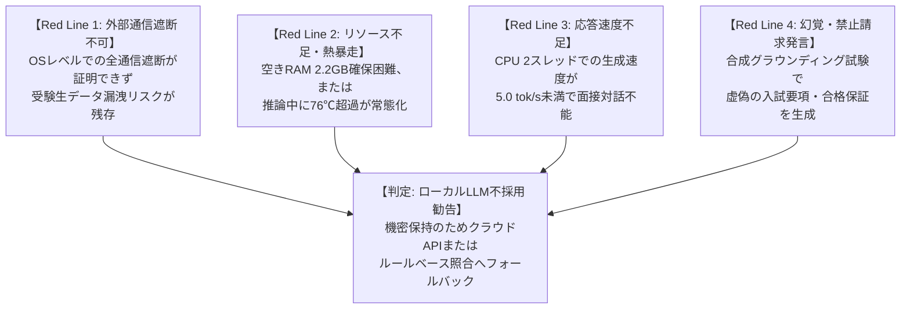

# SOGH: ローカルLLM実用性・安全性評価フレームワークと不採用判断基準

**策定日**: 2026-11-08  
**担当**: Google Antigravity (ローカルAI研究・安全性・実用性評価専門)  
**対象ハードウェア**: ASUS TUF Gaming FX505DY (AMD Ryzen 5 3550H / RAM 8GB / APU)  
**対象モデル候補**: Qwen3-1.7B-Q4_K_M (CPU実行・2スレッド制限)

---

## 1. 目的と基本姿勢

SOGHの将来サービス（公式入試DB、面接練習、追質問、講評、情報検索）において、その一部をローカルLLMで処理することが**「安全性・性能・費用・品質」の観点で実用的かどうか**を信頼できる技術的証拠によって評価・判断するための枠組みを定めます。

> **最重要原則**:  
> 私たちの使命はローカルLLMを無理に採用させることではありません。  
> 品質や安全性が十分でなければ、**「SOGHにおいてローカルLLMを採用すべきではない（クラウドAPI専任または別アーキテクチャ採用）」という不採用の結論を導くことも正当な研究成果**です。

---

## 2. 実用性評価の4大軸 (Evaluation Dimensions)

| 評価軸 | 測定・評価対象 | 評価指標 / 目標基準 | 測定方法（実モデル解禁後の安全測定） |
|---|---|---|---|
| **① 安全性 (Safety & Containment)** | ハードウェア保護 機密・オフライン隔離 | - 物理空きRAM >= 2,200 MB常時維持 - CPUダイ温度 < 76.0℃ - OSレベルでの外向き通信完全遮断 - PII・秘密トークン漏洩 0件 | - Win32 RAM監視 - HWiNFO64共有メモリ監視 - ファイアウォール/パケットログ監査 - 合成敵対的プロンプト注入試験 |
| **② 性能 (Performance Bounds)** | 応答速度 ハードウェア負荷 | - 推論速度 >= 8.0 tokens/sec (CPU 2スレッド) - 初回モデルロード時間 <= 5.0 秒 - ハングアップ・タイムアウト 0件 | - 単調クロック計測 (`time.perf_counter`) - `supervised_inference_runner.py` |
| **③ 費用・運用 (Cost & Operation)** | 端末電力・機材負荷 クラウドAPIとの対比 | - クラウドAPI（Gemini Flash等）従量課金 vs 専用端末常時/オンデマンド待機電力・寿命劣化 - 運用・保守・例外復旧コスト | - ワットチェッカー/APU TDP消費電力換算 - トークン単価比較試算シート |
| **④ 品質 (Grounding Quality)** | ハルシネーション耐性 入出力契約適合 | - 公式要項・DBからのハルシネーション率 0.0% - 禁止請求（合格保証・完全再現等）発言 0件 - 入出力契約（JSONスキーマ）完全準拠率 100% | - 筑波大AC入試等FAQベンチマーク - 決定論的グラウンディングエンジン |

---

## 3. ローカルLLM「不採用 (NO-GO)」を勧告する明確なレッドライン (Red Lines)

以下の条件のいずれか1つでも該当した場合、AntigravityはSOGHにおけるローカルLLMの採用見送り（不採用）を正式に勧告します。

1. **Red Line 1: 完全なネットワーク隔離がOSレベルで証明できない場合**
   - プロキシ環境変数等に依存した不完全な対策しか取れず、C/C++バイナリからのRawソケット通信やDNS漏洩をOSレベル（Windows Defender Firewall API / AppContainer）で完全遮断できない場合。
2. **Red Line 2: 安定的なリソース確保または熱安全性が維持できない場合**
   - ゲーミングPCの空き物理RAM 2,200 MBの安定確保が難しく、またはCPU温度が頻繁に 76.0 ℃ を超えて安全停止が多発し、実サービスとして成立しない場合。
3. **Red Line 3: 応答性能が対話体験の許容限界を下回る場合**
   - CPU 2スレッド制限下での生成速度が 5.0 tokens/sec 未満に低迷し、面接練習や質問応答として実用的な応答速度を提供できない場合。
4. **Red Line 4: 根拠のない虚偽発言（ハルシネーション）を抑止できない場合**
   - 大学入試公式DBのコンテキストを与えても、ローカルLLM特有の文脈喪失により出願資格や日程を捏造・誤認し、決定論的グラウンディング検証で合格率が要求基準（100%）に達しない場合。

---

## 4. 実モデル解禁前の安全な合成試験・スタブ試験計画

現時点では `HOLD_REAL_MODEL_RUN.txt` を厳格に維持し、実モデルの推論は行いません。  
その代わりに、以下の**スタブ・合成試験**によって評価基盤の精度を高めます。

1. **ファイアウォールAPI連動スタブの設計**:
   Windows Defender Firewall（`netsh advfirewall` または PowerShell `New-NetFirewallRule`）を用いて、推論バイナリのアウトバウンド通信をOSレベルでブロックするスクリプトのプロトタイプ作成と、その失敗ケースの合成検証。
2. **合成負荷・レイテンシシミュレータ**:
   トークン生成速度（3 tok/s, 5 tok/s, 10 tok/s）やメモリ消費（1.5GB, 2.0GB, 2.5GB）をシミュレートするダミー子プロセスを用いた、監視・タイムアウト機構の境界値ストレステスト。
3. **Claude Code / ChatGPT Work との最小入出力契約のスタブ検証**:
   面接エンジンや本番DBに依存せず、入出力JSONフォーマットが契約スキーマ（`LOCAL_AI_INTEGRATION_CONTRACT_V1.md`）に合致しているかをスタンドアロンで検証するテストの拡充。
